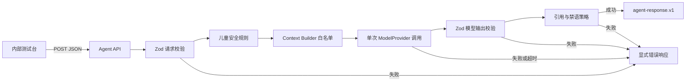

# 元珑 Agent API 与开发测试台

## 本阶段目标

把 `agent-core` 从可单测的函数推进为可通过 HTTP 调用的纵向链路，同时保持测试页面与正式 App 解耦。

## 模块边界

### `packages/agent-core`

只处理 Agent 领域逻辑，不知道 HTTP、CloudBase、数据库和页面。

- `contracts.ts`：请求、模型草稿和最终结果结构。
- `context-builder.ts`：只把审核事实和可用证据交给模型。
- `policy.ts`：检查引用、儿童表达长度、禁语和记忆候选证据。
- `run-agent.ts`：按固定顺序执行一次 Agent 调用。
- `agent-error.ts`：Agent 固定错误码。
- `safety-response.ts`：走失、隐私和主动停止的业务安全回应。

### `services/agent-api`

负责 HTTP 协议，不包含产品业务状态。

- `app.ts`：路由、请求解析、Agent 调用和错误到 HTTP 状态的映射。
- `http-contract.ts`：接口路径、成功结构和错误结构。
- `server.ts`：Node 本地开发适配器；后续 CloudBase 只替换这一层。
- `development-provider.ts`：固定开发 Provider，不调用真实模型。
- `public/`：内部 JSON 测试台，不是正式 UI。

## 固定接口字符串

| 类型 | 字符串 | 含义 |
|---|---|---|
| 健康检查 | `GET /api/v1/health` | 确认服务进程可响应 |
| 开发样例 | `GET /api/v1/development/spot-feedback-fixture` | 返回太和门测试请求 |
| Agent 调用 | `POST /api/v1/agent/spot-feedback` | 执行一次 Spot 回应 |
| 请求版本 | `agent-request.v1` | 当前请求契约版本 |
| 响应版本 | `agent-response.v1` | 当前响应契约版本 |
| Prompt 版本 | `yuanlong.spot-feedback.v1` | 当前提示词版本 |
| 成功状态 | `ok` | HTTP 层成功 |
| 失败状态 | `error` | HTTP 层失败 |

## 固定错误码

### HTTP 输入错误

- `INVALID_JSON`：请求体不是 JSON。
- `INVALID_REQUEST`：JSON 不符合请求 Schema。
- `METHOD_NOT_ALLOWED`：HTTP 方法错误。
- `ROUTE_NOT_FOUND`：路径不存在。
- `REQUEST_TOO_LARGE`：请求体超过 128KB。

### Agent 错误

- `NO_USABLE_EVIDENCE`：没有可交给模型的已验证证据。
- `PROVIDER_TIMEOUT`：Provider 超过 4 秒。
- `PROVIDER_FAILURE`：Provider 主动报错。
- `MODEL_OUTPUT_INVALID`：模型输出不符合 Schema。
- `MISSING_REFERENCE`：模型引用了上下文之外的 ID。
- `POLICY_VIOLATION`：模型输出违反儿童表达或记忆规则。

### 未分类错误

- `UNEXPECTED_ERROR`：开发阶段未分类的代码错误；原始错误信息直接展示。

## 性能边界

- 一次请求只调用一次 Provider。
- 不重试，不切备用模型，不访问数据库，不调用地图。
- Provider 最长等待 4 秒。
- 请求体最多 128KB。
- 本地开发 Provider 固定等待 20ms，便于观察异步链路。
- Agent Core 的上下文最多包含 20 条事实和 20 条证据，限制由 Zod 在进入模型前执行。

## 当前明确没有实现

- 阿里百炼／通义真实 Provider。
- CloudBase 函数适配器和 MySQL。
- 用户登录、家庭账户和儿童档案。
- Zone、Landmark、Spot、Quest 数据读取。
- Journey 状态机、推荐和奖励。
- ASR、TTS、地图、媒体存储。
- 正式 App UI。

这些缺失不会由当前代码假装成功；对应接口在实现前不会返回模拟的生产结果。
